# finetune — Lightweight Smoking-Status Classification from EHR Snippets

**A cost-first study of how small an open-source model can get while still classifying smoking status (CURRENT / FORMER / NEVER / UNKNOWN) from regex-extracted ~±100-token EHR note snippets, at million-snippet scale.**

> **Status (2026-10-28): research phase complete — design contract v0.9.1, 25-source study queue resolved. No model has been trained yet; starter scripts are syntax-checked only. Next gate: zero-DUA smoke experiments E0–E4.**

---

## 1. The problem

A production EHR pipeline pre-filters clinical notes with regex (`smok`, `tobacco`, …), extracts ~±100 tokens around each match, and asks a model for exactly one label:

| Label | Meaning (note-level, at the note's reference time) |
|---|---|
| `CURRENT` | Explicit ongoing combustible-tobacco use. **Ratified one-year rule: quit < 1 year ago ⇒ `CURRENT`.** |
| `FORMER` | Explicit prior use with cessation ≥ 1 year before the note. |
| `NEVER` | Explicit lifetime never-use (hard rule: **missing evidence is never inferred as NEVER**). |
| `UNKNOWN` | No mention / retrieval-negative / timing unresolved / family-history only / conflicting evidence. Reason subtype is stored separately. |

Scope is deliberately narrow: **note-level status at the note's own reference time** — longitudinal patient reconciliation, pack-years, and quit-date extraction are separate sideways scopes (see Phase 3+ below). The deciding metric is **cost per million snippets**; latency is secondary. Clinical reliability is not secondary: CURRENT recall/precision and the UNKNOWN subtypes are first-class metrics.

**Why this is hard:** public labeled data is tiny and DUA-gated (~500 notes for the canonical 2006 challenge); clinical notes are 33–54% duplicated text; smoking evidence is frequently copy-forwarded; prompt-based classifiers plateau well below classifier-head fine-tuning; and label taxonomies differ across every corpus we use.

## 2. Pipeline at a glance

Full renderable version: **[`research/pipeline-diagram.md`](research/pipeline-diagram.md)** (Mermaid; renders on GitHub).

```mermaid
flowchart LR
    A["0·Ingest<br/>privacy + provenance"] --> B["1·Preprocess<br/>sections + note date"]
    B --> C["2·Trigger retrieval<br/>recall-first regex + audit"]
    C --> D["3·Crops<br/>sentence-aligned ±100 tok<br/>dedupe · boilerplate out"]
    D --> E["4·Labels<br/>4-way + one-year rule"]
    E --> F["5·Arms A/B/C/D/E/G"]
    F --> G["6·Aggregate crops→note<br/>auditable precedence"]
    G --> H["7·Abstain<br/>θ → expanded ctx → review"]
    H --> I["8·Eval<br/>patient-disjoint · locked tests"]
    I --> J["9·Serve & cost<br/>$/M decided here"]
```



Stage contracts, boundary tests B1–B11, and risks R1–R7 live in **[`research/pipeline-design.md`](research/pipeline-design.md)**.

## 3. Model arms (wave-1 configs, locked)

| Arm | Model | Role | Notes |
|---|---|---|---|
| **C** ★ | BioClinical-ModernBERT-base + 4-way head | **Primary** | BF16, 3 seeds, eff. batch 32, ≤5 epochs, max_len 512, truncation refusal |
| D | Plain ModernBERT-base | Ablation | Isolates the value of clinical pretraining |
| E | Ettin-32M | Cost upset | Fits crops at max_len 256 |
| A | TF-IDF word+char n-grams → LR / LinearSVM | Floor guard | If A ≈ C, the neural gradient is noise — redesign crops |
| B | MiniLM frozen 384-d + LR head | Fallback only | Priority dropped after few-shot evidence (below) |
| G | Qwen3-0.6B SFT LoRA | Challenger | Source-order crops only; instruction as prefix (verified: reordering hurt decoders on smoking, −10.1%, p=0.018) |

**Deployment gate (pre-registered):** the smallest model within 1 macro-F1 point of the best (95% CI overlap accepted) without losing >2 pp CURRENT recall — reported alongside its $/M.

## 4. What the evidence says (verified, not assumed)

All facts below were verified first-hand against full texts/abstracts in the 25-item study queue (`research/pipeline-design.md` §12, `research-log.md` entries 1–12).

| Finding | Source | Design consequence |
|---|---|---|
| Classifier-head full fine-tuning reaches F1 ≈ 0.85–0.90 on 4-class smoking status | i2b2-2006 winners; Palmer 2019 (0.90 on i2b2-2006 **and** local notes) | Encoder-first; full fine-tuning is the primary path |
| Prompt-verbalizer classification plateaus ~0.67 micro-F1 even with the full 398-note training set; few-shot prompting only 0.35–0.47 macro-F1 | Landi & Alleva arXiv 2312.09469; KOTI, BMC MIDM 2025 | Few-shot arms are fallbacks, never primary |
| For smoking specifically, the significant gain is **evidence-in-window vs tail-truncation** (+15.8–21.6% F1, p<0.001) — template placement itself is not significant | KOTI full text (N2C2 smoking task, 502 notes) | Trigger-anchored crops, not template tricks |
| Full cross-patient dedup of training notes **hurts** smoking F1 (−11.9% ClinicalBERT, −32.6% GatorTron); within-note + boilerplate removal helps (+14.2%) | Landi & Alleva arXiv 2312.09469 | Dedupe within notes + filter boilerplate; **never** cross-patient train-side dedup |
| Patient leakage is real: 3–8% same-patient sentences across CV folds when splits aren't patient-stratified | MSEP (JMIR 2026) | Patient-disjoint splits + template-cluster checks are mandatory |
| Cross-corpus degradation: 0.901 in-domain → 0.774 cross-domain (−13 pp) | n2c2/UW 2022 (ocad012) | Risk R7: per-corpus locked tests, no blended metrics |
| ClinicalBERT for quantitative smoking fields: 0.97 holdout / **0.86 external**; gpt-oss-20B zero-shot only 0.72–0.79 | SmokeBERT, JCO CCI 2025 | Teacher scope locked to 4-class **status**; pack-years/quit-dates are sideways scope |
| 19% of current tobacco users are documented **only** in narrative text | Lybarger, JAMIA 2023 (ocad073) | Motivates extraction; retrieval audit lane (random 200 + enriched 50) |
| Clinical text is 33–54.2% duplicated; copy-forward carries much of the smoking history | Steinkamp 2022; dedup paper | B7 dedup policy rewired (see above) |

## 5. Repository map

```
├── MASTER_CONTEXT.md          # single source of truth: user, scope, phases, hypotheses
├── findings.md                # narrative synthesis of everything verified
├── research-log.md            # decision timeline (entry per research pass)
├── research-state.yaml        # autoresearch state: contract version, verified list, next move
├── research/
│   ├── pipeline-design.md     # ★ design contract v0.9.1 — stages 0–9, B1–B11, R1–R7, study queue S-1..S-25
│   ├── pipeline-diagram.md    # Mermaid diagrams: end-to-end flow, arms, dedup rules
│   ├── external-report-2026-10-28.md    # external expert report #1 (verbatim)
│   └── external-report2-guide-2026-10-28.md  # external expert report #2 (verbatim)
├── literature/
│   └── survey.md              # verified literature + dataset cross-check + pricing snapshot
├── src/
│   ├── extract_windows.py     # candidate crop extraction (char-offset preserving; no labels)
│   ├── train_encoder.py       # encoder classifier starter (CSV: text,label,patient_id,note_id,split,leakage_group)
│   ├── train_generative.py    # optional Qwen3-0.6B LoRA starter
│   └── benchmark_encoder.py   # warm sequential-batch end-to-end latency/throughput benchmark
├── data/                      # empty — real corpora arrive only after DUA (never committed)
├── experiments/               # reserved for E0–E4 smoke outputs
├── paper/                     # reserved
└── to_human/                  # reserved
```

**Read order for newcomers:** `MASTER_CONTEXT.md` → `research/pipeline-design.md` → `research/pipeline-diagram.md` → `findings.md` → `research-log.md`.

## 6. Datasets & access (verified 2026-10-28)

| Corpus | Size | Access | Use in this project |
|---|---|---|---|
| **i2b2/n2c2-2006 Smoking Challenge** | ~502 discharge summaries, 5 native labels → our 4 | DUA-gated (portal; TLS cert issue — manual signing in progress) | Primary gold benchmark once DUA executes |
| **SHAC** (n2c2/UW 2022) | 4,405 social-history sections (4,480 in the 2021 creation paper) | PhysioNet credentialing **+** UW DUA (two gates) | Tobacco event extraction; taxonomy `{none, current, past}` |
| **SDOH-NLI** | 29,335 split items | Ungated, CC-BY-4.0 (tasksource) | Format/smoke corpus **only** — not a label source |
| **Wright synthetic LCS benchmark** | 3,000 notes + reference labels | CC-BY-4.0 — `github.com/vclic/smokingbenchmark` (+ `smokingeval`) | E2 pipeline-comparability set + one-year-rule sensitivity slice — **never gold** (its rules: any documented quit ⇒ FORMER) |
| **MIMIC-III** | — | Credentialed | Deferred (Phase 3+) |

**Label taxonomies differ at the boundaries.** Every corpus's label file is emitted separately and never mixed; mappings live in the harmonization register §9-4.3 of the design doc.

## 7. Privacy & compliance posture

- **No raw ePHI leaves the institution-approved environment.** A policy gate (`policy_can_egress()`) defaults to false; cloud calls require an executed BAA or de-identified/public data.
- **Ratified teacher route (2026-10-28):** cloud APIs **on public/de-identified corpora only** first; privately hosted gpt-oss-20B is a Phase-3 gate decision. Regardless of route, no raw ePHI to any cloud API.
- **Teacher scope is 4-class status only** — zero-shot teachers are weak on pack-years/quit-dates (verified 0.72–0.79 vs 0.97 for a fine-tuned clinical encoder).
- De-identification basis: HHS OCR guidance — Expert Determination or Safe Harbor (content reviewed 2025-02-03). Cropping is not de-identification; the BAA boundary is enforced in Stage 0.
- No auto-uploads to the HF Hub (`push_to_hub=False` in all training configs).

## 8. Cost model

The project's deciding number:

```
$/M snippets = 1,000,000 × H / (3600 × R)
                 H = GPU $/hour,  R = snippets/second (warm, incl. tokenization)
```

Reference points gathered so far (per 1,000 notes, cloud frontier models): Luna $0.12–0.21 … Sonnet $3.76–6.61; prompt caching cut Sonnet cost 47%; reasoning-model payloads ran ~15k input tokens/note because of answer options. The fine-tuning comparison arms are budgeted at **$50–200 total**; local M4/16 GB is prototype-only (verified MPS OOM lesson: fp32 LoRA bs=8 @512 OOMs — use bf16 + grad checkpointing + small batches).

## 9. Roadmap

| Phase | Content | Status |
|---|---|---|
| 1 | Research: datasets, models, methods, architecture, costs (8 deliverables) | ✅ complete — design v0.9.1 |
| — | **E0–E4 zero-DUA smokes**: trigger sanity, MPS encode smoke, E2 dry run on the Wright benchmark, TF-IDF floor, cost baseline | ⏭ next |
| 2 | DUA execution (i2b2 + SHAC); dataset construction kit + labeling policy | ⏳ user-side signing |
| 3 | Fine-tune arms A–G on rented GPU ($50–200); comparison report | pending Phase 2 |
| 4 | Winner deployment recipe + dynamic-INT8 slot + real-environment validation | pending Phase 3 |
| 5 | Real-EHR adaptation (self-training/AL + teacher decision) — PHI never leaves | pending Phase 4 |

## 10. Quickstart (development only — no labeled data yet)

```bash
python3 -m venv .venv && source .venv/bin/activate
pip install torch transformers pandas scikit-learn numpy
# optional for the generative arm / HF datasets:
# pip install peft accelerate datasets

# inspect the crop extractor (module; requires a fast tokenizer with offset mappings)
python -c "import src.extract_windows as e; print(e.CANDIDATES.pattern[:80])"

# starters accept --help; they refuse to pretend data exists
python src/train_encoder.py --help
python src/benchmark_encoder.py --help
python src/train_generative.py --help
```

Environment facts: Apple M4 / 16 GB / MPS for prototyping; `torch 2.8.0`, `transformers 4.57.0`; `peft`/`accelerate`/`datasets` are **not** installed yet. Rented GPU (HF Jobs A10G/L4) is the benchmark environment. `src/*` scripts are starters — **none have been executed against real data**.

## 11. Evaluation contract (non-negotiable)

- Patient-disjoint, hash-deduped, template-cluster-checked splits; one locked test set per source corpus, untouched by any optimization.
- **macro-F1 primary**; per-class P/R/F1; CURRENT recall and precision reported separately; ECE + risk-coverage; UNKNOWN-subtype breakdown; retrieval-layer FN rate; full-pipeline metrics never blended with crop-classifier metrics.
- Patient-cluster bootstrap CIs; paired comparisons; α = 0.1 randomization for 2006 comparability.
- The teacher's score is **never** ground truth anywhere in eval; human-only locked tests gate everything.

## 12. Documentation index

| File | What it is |
|---|---|
| [`MASTER_CONTEXT.md`](MASTER_CONTEXT.md) | User, pipeline, scope, hypotheses, phases |
| [`research/pipeline-design.md`](research/pipeline-design.md) | Design contract v0.9.1 — the implementation must conform and log deviations |
| [`research/pipeline-diagram.md`](research/pipeline-diagram.md) | Mermaid diagrams (end-to-end, arms, dedup rules) |
| [`findings.md`](findings.md) | Narrative synthesis of all verified findings |
| [`research-log.md`](research-log.md) | Chronological decision log (12 research passes) |
| [`research-state.yaml`](research-state.yaml) | Machine-readable state: contract version, verified items, next move |
| [`literature/survey.md`](literature/survey.md) | Literature survey, dataset cross-check, pricing snapshot |

## 13. License, citation, contact

License: TBD (research artifacts are being prepared for public release; code and data licensing decisions are recorded per artifact). Third-party datasets keep their own licenses and DUAs — nothing gated is redistributed here.

Citation: not yet published. Until then, cite this repository:
`laxmideepak/finetune — Lightweight Smoking-Status Classification from EHR Snippets (2026), https://github.com/laxmideepak/finetune`.

Maintainer: [@laxmideepak](https://github.com/laxmideepak). Issues and design critiques are welcome — every empirical claim in this repo is expected to come with a source anchor or an experiment ID.
