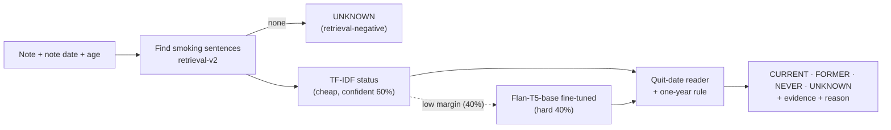

<div align="center">

# 🚭 finetune

### Lightweight Smoking-Status Classification from EHR Snippets

*How small can an open-source model get while still reading smoking status correctly —<br/>at a million snippets, for the lowest cost per million?*

<br/>


<br/>

[**The problem**](#-the-problem) ·
[**Pipeline**](#-pipeline-at-a-glance) ·
[**Model arms**](#-model-arms) ·
[**Recommended model**](#-recommended-model-2026-10-30) ·
[**Evidence**](#-what-the-evidence-says) ·
[**Quickstart**](#-quickstart) ·
[**Repo map**](#-repository-map) ·
[**Roadmap**](#-roadmap)

</div>

---

## 🎯 The problem

A production EHR pipeline pre-filters clinical notes with regex (`smok`, `tobacco`, `tob`, …), cuts out a sentence-aligned window of roughly ±100 tokens around each match, and asks a model for **exactly one label**:

| | Label | Meaning (note-level, at the note's reference time) |
|:-:|---|---|
| 🔴 | **`CURRENT`** | Explicit ongoing combustible-tobacco use. **One-year rule: quit < 1 year ago ⇒ `CURRENT`.** |
| 🟠 | **`FORMER`** | Explicit prior use with cessation ≥ 1 year before the note. |
| 🟢 | **`NEVER`** | Explicit lifetime never-use. *Missing evidence is never read as NEVER.* |
| ⚪ | **`UNKNOWN`** | No mention · retrieval-negative · timing unresolved · family-only · denial-only · conflicting. The reason is stored separately. |

> [!IMPORTANT]
> **The deciding number is cost per million snippets.** Latency is secondary. Clinical reliability is not: `CURRENT` recall/precision and the `UNKNOWN` reasons are first-class metrics.

<details>
<summary><b>Why this is hard</b></summary>

<br/>

- Public labeled data is tiny and behind data-use agreements (~500 notes for the canonical 2006 challenge).
- Clinical notes are 33–54% duplicated text, and smoking history is often copy-forwarded.
- Prompt-based classifiers plateau well below classifier-head fine-tuning.
- Every corpus uses a different label taxonomy, and they disagree exactly at the boundaries.
- The one-year rule needs **date arithmetic** — the note date versus the quit date.

</details>

---

## 🧭 Pipeline at a glance

```mermaid
%%{init: {'theme':'base','themeVariables':{'primaryColor':'#eef4ff','primaryBorderColor':'#1f6feb','lineColor':'#57606a','fontSize':'14px'}}}%%
flowchart LR
    A["🔒 0 · Ingest<br/>privacy + provenance"] --> B["🗂️ 1 · Preprocess<br/>sections + note date"]
    B --> C["🔎 2 · Trigger retrieval<br/>recall-first regex + audit"]
    C --> D["✂️ 3 · Crops<br/>sentence-aligned ±100<br/>dedupe · boilerplate out"]
    D --> E["🏷️ 4 · Labels<br/>4-way + one-year rule"]
    E --> F["🧠 5 · Model arms<br/>A · B · C · D · E · G"]
    F --> G["🧮 6 · Aggregate<br/>crops → note"]
    G --> H["🚦 7 · Abstain<br/>θ → wider context → review"]
    H --> I["📏 8 · Evaluate<br/>patient-disjoint · locked tests"]
    I --> J["💵 9 · Serve & cost<br/>$ / M decided here"]

    classDef hot fill:#fff1e5,stroke:#d1242f,color:#24292f;
    class C,J hot;
```



Stage contracts, boundary tests B1–B11 and risks R1–R7 → **[`docs/design/pipeline-design.md`](docs/design/pipeline-design.md)** · more diagrams → **[`docs/design/pipeline-diagram.md`](docs/design/pipeline-diagram.md)**

---

## 🧠 Model arms

| Arm | Model | Role | Configuration |
|:-:|---|---|---|
| **C** ⭐ | BioClinical-ModernBERT-base + 4-way head | **Primary** | BF16 · 3 seeds · eff. batch 32 · ≤ 5 epochs · max_len 512 · refuses truncation |
| **D** | ModernBERT-base | Ablation | Isolates the value of clinical pre-training |
| **E** | Ettin-32M | Cost upset | Crops at max_len 256 |
| **A** | TF-IDF word + char n-grams → LR / LinearSVM | Floor guard | If A ≈ C, the neural gain is noise — redesign the crops |
| **B** | MiniLM frozen 384-d + LR head | Fallback only | Deprioritised after the few-shot evidence |
| **G** | Qwen3-0.6B SFT LoRA | Challenger | Source-order crops; instruction as prefix only |

> [!NOTE]
> **Deployment rule (pre-registered):** the smallest model whose macro-F1 is non-inferior to the best (paired patient-cluster bootstrap, margin 1 point) **without** losing more than 2 points of `CURRENT` recall — reported with its $/M.

---

## 🏆 Recommended model (2026-10-30)

> [!TIP]
> **Fine-tuned Flan-T5-base (250M) on evidence sentences**, with a rule-based quit-date reader for the one-year rule. Trains in minutes on a CPU; no GPU used. A TF-IDF → Flan cascade cuts cost (exploratory; see below). Claims below were independently audited ([`experiments/audit-2026-10-30`](experiments/audit-2026-10-30/analysis.md)).



#### Status classifier on human-written text (SDOH-NLI, openly licensed MTSamples sentences; native labels, no one-year rule)

| Model | 5-fold CV (pooled) | Locked test (opened once) | NEVER F1 (CV) |
|---|:-:|:-:|:-:|
| 🥇 **Flan-T5-base, fine-tuned** | **0.868** | **0.877** | **0.68** |
| Cascade: TF-IDF → Flan on 40% | 0.865 | — | 0.70 |
| Flan-T5-large (780M), fine-tuned | 0.813 | — | 0.47 |
| Flan-T5-small, fine-tuned | 0.795 | — | 0.49 |
| TF-IDF word+char SVM (same training rows as Flan) | 0.791 | 0.616 | 0.55 |
| Flan-T5-large, zero-shot + policy guard | 0.750 | — | 0.48 |
| SciBERT, generic fine-tune | 0.682 | — | 0.10 |
| Trained on synthetic notes only | 0.599 | — | 0.24 |

Flan-T5-base vs TF-IDF on the same rows: **+0.077** on CV (95% CI +0.016…+0.142, wins 5/5 folds). With NEVER and UNKNOWN merged (removing SDOH-NLI's inconsistent NEVER labels) Flan still wins: **0.934 vs 0.878** (+0.057, CI +0.012…+0.104). Locked test: 0.877 vs 0.616, but that gap rests on 15 smoking-labelled premises (2 NEVER items carry ~64% of it), and validation showed no clear difference (0.846 vs 0.831) — treat the test gap as direction, not size.

#### Full pipeline with the one-year rule (Wright synthetic, 600 **dev** notes — reused across experiments, not a held-out test)

| Pipeline | One-year macro-F1 | Status accuracy | CURRENT R / P |
|---|:-:|:-:|:-:|
| Flan-T5-base + quit-date reader | 0.972 | 599 / 600 | 1.00 / 1.00 |
| TF-IDF + quit-date reader | 0.973 | 600 / 600 | 1.00 / 1.00 |
| TF-IDF learning the one-year labels directly | 0.888 | — | 0.92 / 1.00 |

#### Cost on CPU (assumed $0.17/h for 4 vCPU)

| Setup | ≈ $ per million sentences |
|---|:-:|
| TF-IDF only | 0.04 |
| Cascade (Flan on 40%) — *exploratory, operating point chosen on CV* | 2.07 |
| Flan-T5-base on everything | 5.08 |
| Published cloud-LLM full-note costs | 120 – 6,610 per million notes |

> [!CAUTION]
> SDOH-NLI's test split has only 15 smoking-labelled premises, and its labels differ from our policy at the edges (cigars, third parties). Wright is synthetic. **No clinical gold data has been used yet** — i2b2-2006 awaits its DUA.

<details>
<summary><b>How we got here — experiment trail</b> (every plan committed before its run)</summary>

<br/>

| Exp | Question | Verdict |
|:-:|---|---|
| E-wave-1 | Does retrieval find the evidence? | Lexicon v2: missed notes 27 → 3 of 2,750 |
| H5 | Can a model learn the one-year rule? | No — a quit-date reader + note date does it (0.888 → 0.947) |
| H6 | Whole section or evidence sentence? | Evidence sentence: 600/600 status on synthetic (0.973) |
| H7 | Does synthetic training transfer to human text? | No: 0.60 vs 0.79 in-domain |
| H8 | SciBERT, generic recipe | Refuted (0.682) |
| H9 | Flan-T5 zero-shot / fine-tuned | Fine-tuned base wins (0.868) |
| H10 | Zero-shot + policy guard | Refuted (0.750) |
| H11 | 3-model vote | Refuted (0.840 < best single) |
| H12 | Locked-test confirmation | Confirmed in direction (SDOH test 0.877 vs 0.616 on 15 smoking items; Wright **dev** 0.972) |
| Audit | Independent adversarial review | No leakage; 6 wording corrections applied (fair baseline 0.791; test gap fragile) |
| H13 | Cascade for cost | 97% of the gain at ~40% of the cost (exploratory) |
| H14 | Is bigger better? Flan-T5-large (780M) | No: 0.813 vs base 0.868 at this data size |

Write-ups: [`experiments/*/analysis.md`](experiments) · leaderboard: [`experiments/sdoh-cv-leaderboard.json`](experiments/sdoh-cv-leaderboard.json) · E-wave-1: [`docs/results/e-wave-1-results-2026-10-29.md`](docs/results/e-wave-1-results-2026-10-29.md)

</details>

---

## 🔬 What the evidence says

<sub>Every row was checked against the full text or abstract (study queue S-1…S-25 in the design contract).</sub>

| Finding | Source | Design consequence |
|---|---|---|
| Classifier-head full fine-tuning reaches F1 ≈ 0.85–0.90 on 4-class smoking | i2b2-2006 winners · Palmer 2019 | Encoder-first; full fine-tuning is the primary path |
| Prompt-verbalizer classification plateaus ~0.67 micro-F1; few-shot 0.35–0.47 macro-F1 | Landi & Alleva 2312.09469 · KOTI 2025 | Few-shot arms are fallbacks, never primary |
| Evidence-in-window beats tail truncation by +15.8–21.6% F1 | KOTI full text | Trigger-anchored crops |
| Full cross-patient dedup **hurts** smoking F1 (−11.9% / −32.6%); within-note dedup helps (+14.2%) | Landi & Alleva 2312.09469 | Within-note dedup + boilerplate filter only |
| 3–8% same-patient leakage across folds when splits aren't patient-stratified | MSEP, JMIR 2026 | Patient-disjoint splits are mandatory |
| Cross-corpus drop 0.901 → 0.774 (−13 points) | n2c2/UW 2022 | One locked test per corpus, no blended metrics |
| Fine-tuned ClinicalBERT 0.97 vs gpt-oss-20B zero-shot 0.72–0.79 on quantitative fields | SmokeBERT, JCO CCI 2025 | Teacher scope = 4-class status only |
| 19% of current tobacco users are documented **only** in narrative text | Lybarger, JAMIA 2023 | Extraction is worth it; retrieval audit lane |

---

## 🗄️ Datasets & access

| Corpus | Size | Access | Role here |
|---|---|---|---|
| **i2b2/n2c2-2006 Smoking** | ~502 discharge summaries | 🔐 DUA (manual signing in progress) | Primary gold benchmark |
| **SHAC** (n2c2/UW 2022) | 4,405 social-history sections | 🔐 PhysioNet + UW DUA | Tobacco events `{none, current, past}` |
| **Wright synthetic LCS** | 3,000 notes + labels | 🟢 CC-BY-4.0 · [`vclic/smokingbenchmark`](https://github.com/vclic/smokingbenchmark) | E-wave pipeline set + one-year-rule stress test — **never gold** |
| **SDOH-NLI** | 29,335 items | 🟢 CC-BY-4.0 | Format smoke only — not a label source |
| **MIMIC-III** | — | 🔐 Credentialed | Deferred (Phase 3+) |

> [!CAUTION]
> Label taxonomies disagree at the boundaries (e.g. Wright: *any* quit ⇒ FORMER; ours: quit < 1 year ⇒ CURRENT). Each corpus's labels are kept separate; mappings live in the harmonization register (§9-4.3 of the design contract).

---

## 🛡️ Privacy & compliance

- 🔒 **No raw ePHI leaves the approved environment.** `policy_can_egress()` defaults to `false`; cloud calls need an executed BAA or de-identified/public data.
- ☁️ **Teacher route (ratified):** cloud APIs on public/de-identified corpora only; a privately hosted gpt-oss-20B is a Phase-3 decision.
- 🏷️ **Teacher scope = 4-class status only.**
- ✂️ Cropping is **not** de-identification; HHS Expert Determination or Safe Harbor applies.
- 🚫 No automatic uploads to the Hugging Face Hub (`push_to_hub=False` everywhere).

---

## 💵 Cost model

```text
$ / M snippets = 1,000,000 × H / (3600 × R)
                 H = hardware $/hour     R = snippets/second (warm, incl. tokenization)
```

| Reference point | $ / M |
|---|--:|
| Cloud frontier LLMs, full notes (published) | ≈ 120 – 6,610 |
| Base-size encoder, CPU fp32, 4 vCPU (E4, measured) | ≈ 19 – 25 |
| TF-IDF floor, one CPU core (E3, measured) | ≈ 0.15 |
| Base-size encoder on T4 / L4 / A10G | ⏳ pending |

Fine-tuning budget: **$50–200 total**.

---

## 🚀 Quickstart

```bash
python3 -m venv .venv && source .venv/bin/activate
pip install -r requirements/dev.txt          # encoder stack + pytest
# generative arm lives in a separate env:    pip install -r requirements/generative.txt
```

```bash
python scripts/check_env.py                  # verify pins, devices, label policy, data contract
python -m pytest -q tests                    # 77 unit tests
python scripts/smoke_train.py                # offline tiny-model train → save → reload → predict
python src/extract_windows.py --demo         # see the crop extractor on a built-in note
```

<details>
<summary><b>Re-run E-wave-1 on the Wright benchmark</b></summary>

<br/>

```bash
git clone --depth 1 https://github.com/vclic/smokingbenchmark ../smokingbenchmark

# E0 retrieval sanity + E3 TF-IDF floor
python scripts/run_wright_smoke.py --wright-dir ../smokingbenchmark \
    --out experiments/E0_E3_wright_retrieval-v2

# E4 speed baseline (random-weight, ModernBERT-base-shaped; speed only)
python scripts/build_shape_model.py --wright-dir ../smokingbenchmark \
    --splits experiments/E0_E3_wright_retrieval-v2/labels_and_splits.csv \
    --out runs/modernbert-base-shape
python src/benchmark_encoder.py --model runs/modernbert-base-shape/model \
    --csv runs/modernbert-base-shape/dev_crops_le512.csv --device cpu --batch 8 --passes 2
```

</details>

---

## 📁 Repository map

```text
finetune/
├── 📄 README.md
├── 📦 requirements.txt            → requirements/core.txt
├── 📦 requirements/
│   ├── core.txt                  # pinned encoder / inference stack
│   ├── dev.txt                   # core + pytest
│   └── generative.txt            # core + peft + trl (separate env)
│
├── 🧠 src/                        # library + entry points
│   ├── label_policy.py           # ★ single source of truth for labels & the one-year rule
│   ├── data_contract.py          # shared dataset contract for every entry point
│   ├── extract_windows.py        # Stage 3 crop extractor (retrieval-v2)
│   ├── evidence.py               # evidence-sentence view of a crop (H6)
│   ├── quit_resolver.py          # quit-date reader + one-year rule (H5)
│   ├── status_rules.py           # keyword baseline + lifetime-never cues (policy guard)
│   ├── pipeline.py               # ★ end-to-end: note → label + reason + evidence
│   ├── train_encoder.py          # arms C / D / E
│   ├── train_generative.py       # arm G (Qwen3 LoRA)
│   ├── evaluate_generative.py
│   ├── benchmark_encoder.py      # warm throughput → $/M
│   ├── compare_models.py         # paired patient-cluster bootstrap
│   ├── metrics.py
│   └── provenance.py
│
├── 🛠️ scripts/
│   ├── check_env.py              # environment readiness check
│   ├── smoke_train.py            # offline end-to-end smoke
│   ├── run_wright_smoke.py       # E0 + E3 on the Wright benchmark
│   ├── build_shape_model.py      # E4 offline speed model
│   ├── run_h5…h13_*.py           # one runner per experiment (H5–H13)
│   ├── fetch_flan_t5.py          # Flan-T5 from Google's public GCS (no HF Hub needed)
│   ├── compare_sdoh_cv.py        # pooled leaderboard + paired bootstrap
│   └── pipeline_cli.py           # train / predict / bench the pipeline
│
├── 🧪 experiments/               # one folder per hypothesis: protocol.md (locked first) · analysis.md · results/
│
├── ✅ tests/                      # 77 unit tests + synthetic fixture
│
├── 📚 docs/
│   ├── MASTER_CONTEXT.md         # ★ start here: user, scope, phases, hypotheses
│   ├── design/                   # pipeline-design.md (contract v0.9.1) · pipeline-diagram.md
│   ├── results/                  # E-wave-1 write-up
│   ├── literature/               # survey.md — verified literature + pricing
│   ├── external-reports/         # two external expert reports (verbatim)
│   └── tracking/                 # findings.md · research-log.md · research-state.yaml
│
└── 🔒 data/ · paper/ · to_human/   # git-ignored workspaces (never committed)
```

**Read order for newcomers:** [`MASTER_CONTEXT`](docs/MASTER_CONTEXT.md) → [`pipeline-design`](docs/design/pipeline-design.md) → [`pipeline-diagram`](docs/design/pipeline-diagram.md) → [`E-wave-1 results`](docs/results/e-wave-1-results-2026-10-29.md) → [`findings`](docs/tracking/findings.md) → [`research-log`](docs/tracking/research-log.md)

---

## 🗺️ Roadmap

| Phase | Content | Status |
|:-:|---|:-:|
| 1 | Research: datasets, models, methods, architecture, costs | ✅ design v0.9.1 |
| E | **Zero-DUA smokes E0–E4** on the Wright benchmark | ✅ done on CPU |
| H | **H5–H13 on Wright + SDOH-NLI** (no DUA needed) | ✅ Flan-T5-base fine-tuned recommended |
| 2 | DUA execution (i2b2 + SHAC); dataset kit + labeling policy | ⏳ user-side signing |
| 3 | Fine-tune arms A–G on rented GPU ($50–200); comparison report | ⏳ after Phase 2 |
| 4 | Winner deployment recipe + INT8 slot + real-environment validation | ⏳ |
| 5 | Real-EHR adaptation (self-training / active learning) — PHI never leaves | ⏳ |

**Next moves**
- [x] Quit-date reader + note date for the one-year rule (H5)
- [x] Pretrained models without the HF Hub: SciBERT (scispaCy/S3), Flan-T5 (GCS)
- [x] Fine-tune Flan-T5-large (780M) — no, base (250M) is better at this data size (H14)
- [ ] Open the locked Wright test split once for the final pipelines (H15, running)
- [ ] SciBERT with a small-data recipe (H8b, locked, deferred)
- [ ] Validate on i2b2-2006 once the DUA is signed

---

## 📐 Evaluation contract

- Patient-disjoint, hash-deduped, template-cluster-checked splits; **one locked test set per corpus**, untouched by any optimization.
- **macro-F1 primary** · per-class P/R/F1 · `CURRENT` recall and precision separately · ECE + risk-coverage · `UNKNOWN`-reason breakdown · retrieval false-negative rate.
- Patient-cluster bootstrap CIs; paired comparisons.
- A teacher model's output is **never** ground truth in evaluation.

---

<div align="center">

**License:** TBD — third-party datasets keep their own licenses and DUAs; nothing gated is redistributed here.

**Cite:** *laxmideepak/finetune — Lightweight Smoking-Status Classification from EHR Snippets (2026)*, https://github.com/laxmideepak/finetune

Maintained by [@laxmideepak](https://github.com/laxmideepak) · issues and design critiques welcome — every claim here should come with a source or an experiment ID.

</div>
