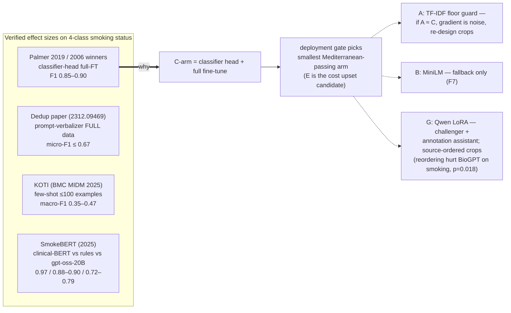

# Pipeline Diagram — Smoking-Status Extraction from EHR Note Crops

> Visual companion to `docs/design/pipeline-design.md` v0.9.1 (as of 2026-10-28, research passes S-1..S-25 complete).
> Render: on GitHub (native Mermaid), or `npx -y @mermaid-js/mermaid-cli -i docs/design/pipeline-diagram.md -o /tmp/pipe.pdf`.

## 1. End-to-end pipeline (Stages 0→9)

```mermaid
flowchart TD
    subgraph G0["STAGE 0 · Ingest, privacy & provenance"]
        IN[("EHR notes<br/>per-note provenance blob:<br/>source_db · note_id · patient_id<br/>note_date · de_id_status")]
        GATE{{"privacy gate<br/>policy_can_egress()"}}
        IN --> GATE
        GATE -- "raw ePHI + no BAA" --> BLOCK["❌ enclave-only<br/>no external calls"]
    end

    subgraph G1["STAGE 1 · Preprocessing"]
        SENT["sentence split<br/>(section-header anchors)"]
        DATE["dates → note reference time"]
    end

    subgraph G2["STAGE 2 · Trigger retrieval (recall-first, hints only)"]
        LEX["regex lexicon:<br/>smok*, tobac*, cigar*, cigaret*,<br/>nicotine, pack-year, ppd, cigs*,<br/>hookah, shisha, snuff, chew*, vape*"]
        AUD["audit lane:<br/>regex-negative sample<br/>(random 200 + enriched 50)"]
    end

    subgraph G3["STAGE 3 · Crop construction"]
        CROP["sentence-aligned merged windows<br/>±100 tokens · budget 512<br/>boundary markers «…»"]
        DEDUP["within-note dedupe<br/>+ boilerplate zones out<br/>(10 BN-NR topics)"]
        SPILL["evidence > budget →<br/>2nd note-context example<br/>(≤1024 tok) — nothing dropped silently"]
    end

    subgraph G4["STAGE 4 · Labeling & dual targets"]
        LAB["4-way: CURRENT · FORMER · NEVER · UNKNOWN(+reason)<br/>one-year rule: quit <1 yr ⇒ CURRENT<br/>conservative UNKNOWN discipline"]
    end

    subgraph G5["STAGE 5 · Model arms (wave-1 configs)"]
        CARM["★ C primary: BioClinical-ModernBERT-base<br/>+ 4-way head · BF16 · 3 seeds"]
        DARM["D: plain ModernBERT-base<br/>(isolates clinical pretraining)"]
        EARM["E: Ettin-32M · max_len 256"]
        AARM["A: TF-IDF word+char → LR + LinearSVM"]
        BARM["B: MiniLM frozen + LR head<br/>(fallback per F7)"]
        GARM["G: Qwen3-0.6B LoRA SFT<br/>completion_only_loss · source-order crops"]
    end

    subgraph G6["STAGE 6 · Aggregation crops → note"]
        AGG["precedence:<br/>1) CURRENT evidence<br/>2) FORMER + cessation<br/>3) NEVER (lifetime)<br/>4) UNKNOWN + reason<br/>every decision logged w/ crop ids"]
    end

    subgraph G7["STAGE 7 · Abstention & uncertainty"]
        CONF["calibrated max-softmax θ<br/>(CURRENT gets higher bar)"]
        ROUT{"confidence ≥ θ?"}
        EXP["expanded-context pass<br/>(1024-token example)"]
        REV["review queue<br/>+ evidence dump"]
        UNK["UNKNOWN label vs abstention<br/>kept as separate fields — never overwritten"]
    end

    subgraph G8["STAGE 8 · Evaluation contract"]
        EVAL["patient-disjoint splits · hash-deduped<br/>locked per-corpus test sets<br/>200–500 hard-case challenge set"]
        MET["macro-F1 primary · per-class P/R/F1<br/>CURRENT-recall/P separately · ECE<br/>family-history misattribution · full-pipeline ≠ crop metrics"]
        GATED["deployment gate:<br/>smallest model within 1 macro-F1<br/>w/o CURRENT-recall −2pp, with $/M"]
    end

    subgraph G9["STAGE 9 · Serving & cost"]
        SERV["HF Jobs A10G/L4<br/>median+P95 latency · R tokens/s<br/>$/M = 1e6·H/(3600·R)<br/>INT8 slot after winner"]
    end

    G0 --> G1 --> G2 --> G3 --> G4 --> G5
    G5 --> G6 --> ROUT
    G6 --> G7
    ROUT -- "yes" --> ANSW["note-level status"]
    ROUT -- "no" --> EXP --> ROUT2{"≥ θ now?"}
    EXP --> ROUT2
    ROUT2 -- "yes" --> ANSW
    ROUT2 -- "no" --> REV
    G8 --> G9
    AUD -. "FN-rate > 5% → revisit lexicon<br/>(not: embedding step-up by default)" .-> LEX
    CONF -. "reliability curves · recalibrate after INT8" .-> SERV

    style CARM stroke:#0a7d32,stroke-width:3px
    style BLOCK stroke:#b71c1c,stroke-width:3px
    style ANSW stroke:#0a7d32,stroke-width:2px
```



## 2. Where the evidence says each arm sits



## 3. Dedup rules (S-25 verified) — what is and isn't deduplicated

```mermaid
flowchart TD
    NOTE["note sentences"] --> WN{"same sentence<br/>twice within note?"}
    WN -- yes --> KEEP1["first occurrence wins<br/>second flagged (weighting bias)"]
    WN -- no --> BOILER{"boilerplate zone?<br/>(attestation · see-flowsheet ·<br/>legal/disclaimer · contact ·<br/>hypothetical instructions)"}
    BOILER -- yes --> OUT["never seeds a crop<br/>(false-negation hazard)"]
    BOILER -- no --> KEEP["eligible crop sentence"]
    CROSS["cross-patient duplicate<br/>(copy-forward across patients)"] --> KEEP2["KEEP — do NOT dedupe train side"/>
    CROSSNOTE["(verified: full cross-patient dedup<br/>−11.9% ClinicalBERT / −32.6% GatorTron<br/>smoking evidence lives in copy-forward text)"] -.-> KEEP2
    EVALNOTE["eval side: patient-disjoint<br/>splits + template-cluster checks"] -.-> NOTE
```

## 4. One-paragraph walk-through

Notes enter behind the Stage-0 privacy gate (raw ePHI never leaves the enclave; teacher-model assistance only on public/de-identified corpora per the ratified 2026-10-28 decision). Stage 1 normalizes text into section-anchored sentences and resolves each note's reference date. Stage 2 runs the recall-first trigger lexicon and separately audits what it misses. Stage 3 builds sentence-aligned ±100-token crops at a 512-token budget — within-note duplicates and boilerplate zones are removed, and any evidence overflow becomes a second, larger note-context example rather than silent truncation. Stage 4 assigns 4-way labels with the ratified one-year rule and a conservative UNKNOWN discipline. Stage 5 trains the arm battery (C primary encoder; D isolates clinical pretraining; E tests size-fits-crops; A guards the floor; B few-shot fallback; G generative challenger with source-ordered crops). Stage 6 aggregates crops to note-level status with explicit, auditable precedence; Stage 7 adds the calibrated abstention lane (threshold → expanded context → review queue). Stage 8 evaluates on patient-disjoint locked tests with the pre-registered deployment gate, and Stage 9 turns the winner into a $/million-snippets cost figure on rented GPU (with a dynamic-INT8 slot), the deciding metric of the project.
